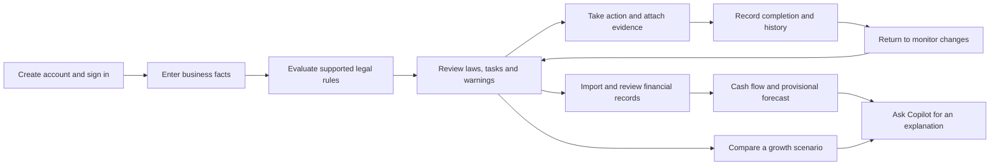
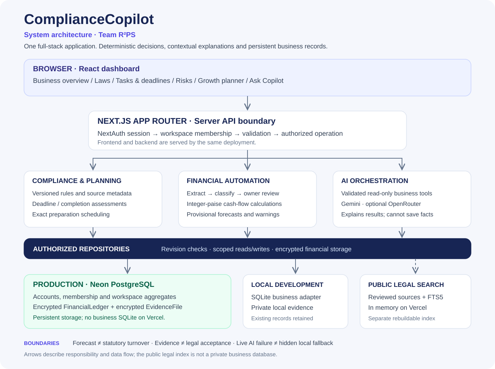
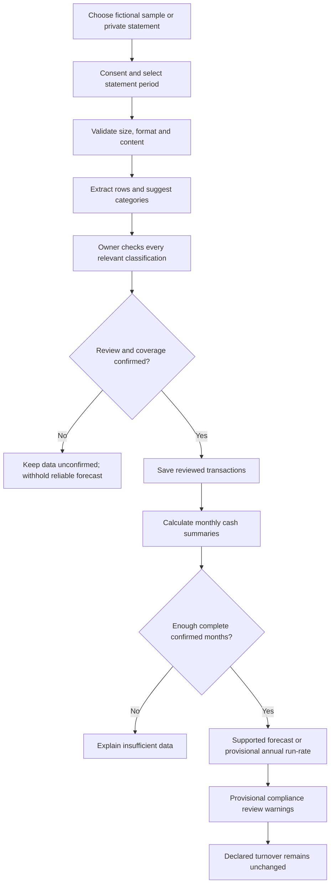
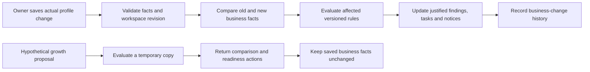
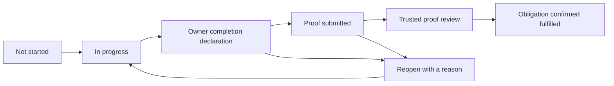
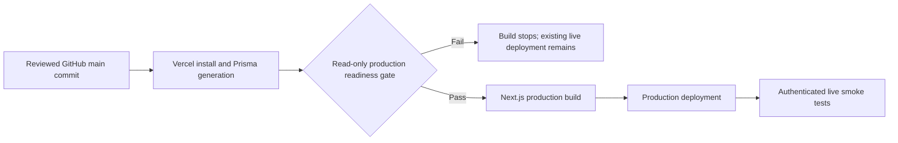

[**Open the live application → compliancecopilot-shayan.vercel.app**](https://compliancecopilot-shayan.vercel.app)

# ComplianceCopilot

### Built by Team R²PS

**Understand what applies. Prepare for what changes. Keep the evidence together.**

ComplianceCopilot helps Indian small and medium enterprises identify how their obligations change as the business grows. It connects reported growth events—hiring, turnover changes, new locations and export plans—to understandable compliance reviews, action lists, supported deadlines and consequences. It combines a source-backed rules engine, task and deadline monitoring, reviewed financial imports, exact calculations and an optional live AI assistant.

[Live application](https://compliancecopilot-shayan.vercel.app) · [Try the public demo](https://compliancecopilot-shayan.vercel.app/demo) · [GitHub repository](https://github.com/shayankhan05/Chanakya-hackthon) · [User walkthrough](docs/USER-WORKFLOWS.md) · [Architecture reference](docs/ARCHITECTURE.md)

> **What the product provides:** decision support and preparation guidance. It does not file returns, issue registrations, verify government acceptance, provide a legal certification, or guarantee that a business will avoid notices. Bank receipts and forecasts are not automatically statutory turnover.

## Contents

- [Problem statement](#problem-statement)
- [The problem and our approach](#the-problem-and-our-approach)
- [How the application works](#how-the-application-works)
- [Architecture](#architecture)
- [Technology stack](#technology-stack)
- [Features and navigation](#features-and-navigation)
- [Financial automation](#financial-automation)
- [AI assistant](#ai-assistant)
- [Rules, deadlines and growth planning](#rules-deadlines-and-growth-planning)
- [Data model and security](#data-model-and-security)
- [Run locally](#run-locally)
- [Environment configuration](#environment-configuration)
- [Production deployment](#production-deployment)
- [Testing and release status](#testing-and-release-status)
- [Repository map](#repository-map)
- [Documentation and team](#documentation-and-team)

## Problem statement

### Context

> An SME's legal obligations are not fixed. They switch on silently as the business grows. Hiring the 10th employee can bring in ESI coverage and the requirement for an Internal Committee under the POSH Act. Reaching 20 employees can bring EPF. Crossing a turnover limit triggers GST registration or e-invoicing. Opening a branch in another state brings a fresh set of state-specific registrations. Most owners only find out when a notice or penalty arrives.

### The challenge

> Design a solution that watches for growth events in a small business, such as new hires, rising turnover, new locations, new product lines or a first export order. For each event, it should tell the owner which new obligations have just switched on, by when they must act, and what the consequences of missing them are.

The thresholds above reproduce the supplied problem context. Actual applicability, deadlines and consequences depend on the relevant law, jurisdiction, eligibility, exceptions and verified business facts; they are not universal automatic conclusions.

## The problem and our approach

The central problem is **the transition from yesterday's obligations to today's obligations**. An owner may know their sales and team size but still struggle to identify what a new hire, branch or export changes, which dates need attention, and what records to prepare. Business facts, spreadsheets, certificates and legal guidance often sit in separate places.

ComplianceCopilot's response is a growth-event-to-action workflow:


| Growth event in the challenge | How the application addresses it |
| --- | --- |
| New hires or a headcount change | Compares workforce facts with supported EPF, ESI and POSH rules, retaining eligibility conditions and missing-information checks. |
| Rising turnover | Reevaluates supported turnover-related screening when actual facts are saved; reviewed receipt forecasts can separately prompt provisional review. |
| A new branch or location | Uses recorded locations and staffing for supported jurisdiction checks; identifies gaps where state-specific coverage is not verified. |
| A first export order or export plan | Uses the saved export fact or hypothetical export scenario to identify supported export/IEC preparation reviews. |
| New products or business activities | Activity and supply facts can be updated in the profile; specialized product-line rules need verified catalogue coverage before an obligation can be asserted. |
| A newly relevant requirement | Connects the finding to preparation actions, documents, task tracking, source-backed dates where available and supported consequence assessments. |

**Implementation boundary:** growth detection uses owner-recorded changes and supported inputs, not an automatic live connection to every HR, accounting or government system. The challenge's references to e-invoicing and new product lines do not imply complete automated coverage of every such trigger. Unverified applicability, dates or penalties remain explicit review gaps.

ComplianceCopilot brings them into one private workspace:

| Owner's question | How the app helps |
| --- | --- |
| Which requirements should I review? | Evaluates saved facts against versioned legal screening rules and explains the conditions. |
| What should I do next? | Provides tasks, document checklists, preparation targets and verified legal dates where available. |
| What if I hire more people or open a branch? | Compares a hypothetical business with the saved profile without changing actual records. |
| What do my bank receipts suggest? | Extracts transactions, asks the owner to review classifications, and calculates cash-flow summaries and provisional sales estimates. |
| Can someone explain this simply? | The configured AI provider can explain authorized records and deterministic tool results in conversational language. |
| How can I demonstrate action taken? | Records completion declarations and private supporting evidence with action history. |

**Example:** a fictional IT business has eight employees and declared annual turnover of ₹18 lakh. It can review its current obligations, compare a proposed total of 50 employees, and inspect whether reviewed receipts suggest a further GST review. A planning conversation does not change its saved employee count or declared turnover.

## How the application works



1. **Describe the business:** activity, location, headcount, turnover, branches, registrations and relevant eligibility facts. Unknown facts can remain unknown.
2. **Review screening results:** see supported requirements, exceptions, missing information and linked sources.
3. **Prepare and track work:** assign tasks, record dates and progress, and keep certificates and evidence together.
4. **Review financial evidence:** confirm extracted transactions before using their summaries in provisional screening.
5. **Plan before changing:** inspect potential hiring, branch, export or turnover changes without altering saved facts.
6. **Ask for help:** use Copilot to explain a result, task, calculation or planning question.

## Architecture



[Download the architecture image as PNG](docs/images/architecture.png) · [Editable SVG source](docs/images/architecture.svg)

**One full-stack application:** Next.js serves both the React interface and server API routes. There is no separate Express backend to start. Production runs on the existing Vercel project with persistent Neon PostgreSQL. Local development can use the existing SQLite adapter.

| Layer | Responsibility | Main code |
| --- | --- | --- |
| Presentation | Responsive dashboard, forms, chat, review dialogs and accessible controls | `app/`, `components/` |
| API boundary | Authentication, workspace authorization, validation, origin checks and rate limits | `app/api/`, `lib/api.ts` |
| Deterministic services | Legal screening, dates, monetary arithmetic, forecasts and scheduling | `lib/engine.ts`, `lib/deadlines.ts`, `lib/financial/`, `lib/planning/` |
| AI orchestration | Provider selection and authorized read-only tools | `lib/ai-provider.ts`, `lib/assistant-tools.ts` |
| Persistence | Accounts, workspace aggregates, encrypted financial ledgers and evidence | `lib/repository.ts`, `lib/evidence-storage.ts`, `prisma/` |
| Public legal retrieval | Versioned source catalogue and searchable excerpts | `lib/legal-catalogue.ts`, `lib/legal-knowledge.ts`, `lib/legal-index.ts` |

The AI explains supplied evidence and tool results. Monetary calculations, rule evaluation and scheduling are performed by application code; they do not depend on an LLM inventing an answer. [See the detailed component, sequence and database diagrams](docs/ARCHITECTURE.md).

## Technology stack

| Area | Technology | Purpose |
| --- | --- | --- |
| Framework | Next.js 15, App Router | Pages, server rendering and API route handlers |
| UI | React 19, TypeScript | Typed interactive components and forms |
| Styling | Tailwind CSS, local shadcn-style components, Radix Slot | Reusable UI primitives and responsive styling |
| Icons | Lucide React | Consistent navigation and action icons |
| Production database | Neon PostgreSQL | Persistent account, business, financial and evidence storage |
| ORM | Prisma 6 | PostgreSQL access, schema and migration management |
| Local database | Node.js `node:sqlite` | Persistent SQLite development adapter |
| Authentication | NextAuth.js 4, credentials provider, JWT sessions | Email/password login and session validation; optional GitHub OAuth |
| Password security | Node.js scrypt, random salts, timing-safe comparison | Password verification without storing plaintext passwords |
| Validation | Zod | Validate profiles, API requests, tools and calculations |
| Primary AI integration | Google Gemini through `@google/genai` | Server-side conversational explanations and tool calling |
| Optional AI provider | OpenRouter | Explicit alternative provider configuration |
| Financial arithmetic | BigInt-based integer paise | Avoid floating-point errors in money calculations |
| Encryption | AES-256-GCM; HKDF-derived or dedicated key | Encrypt financial data and production evidence |
| PDF extraction | `unpdf`, isolated worker | Narrowly supported text-based statement extraction |
| Reports | jsPDF | Downloadable business reports |
| Legal search | SQLite FTS5 | Search public legal-source excerpts; rebuilt in memory on Vercel |
| Tests and tooling | Node test runner, `tsx`, TypeScript, ESLint | Automated regression tests, scripts and static checks |
| Hosting and source control | Vercel, GitHub | Existing deployment and versioned source |

The interface uses local reusable components; the repository does not depend on a separately hosted UI platform. Gemini model selection is configurable rather than guaranteed to a particular model name.

## Features and navigation

The sidebar has **six primary sections**. Calendar, certificates, history, financial records and calculators are supporting views, rather than separate disconnected products.

| Section | What the user sees and does | Example |
| --- | --- | --- |
| **Business overview** | Saved business facts, next actions, deadline attention and reviewed financial snapshots | See what requires attention before starting the day's work. |
| **Applicable laws** | Screening results with reasons, conditions, missing facts and legal-source details | Understand why EPF needs review when planning a larger workforce. |
| **Tasks & deadlines** | Action list, progress, completion declarations, calendar, certificates and preparation planner | Assign a preparation task, attach evidence and record what was actually completed. |
| **Risks & alerts** | Unresolved reviews, deadline issues, certificate warnings and next actions | Open an expiring-license warning and inspect its recorded expiry. |
| **Growth planner** | Hypothetical workforce, turnover, branch and export comparisons; financial planning tools | Compare an eight-person team with a proposed total of 50. |
| **Ask Copilot** | Contextual chat and tax/contribution tools | Ask about a task, saved company facts or a supported calculation. |

### Important supporting controls

| Control | Result |
| --- | --- |
| Business Profile / Settings | Opens the saved profile. Saving a real change reevaluates rules and records a business event. |
| Financial Records | Opens statement extraction, transaction review, summaries and forecast controls. |
| Notifications bell | Opens notices. Marking a notice read does not complete an obligation. |
| Calendar | Displays recorded preparation targets and legal dates with distinct meanings. |
| Registrations & licenses | Records owner-supplied certificates, dates and actual expiry information. |
| Download PDF report / Export business data | Creates an export from the workspace; it does not send a filing to a regulator. |
| Business change history | Shows saved changes and their screening effects. |
| Account & security / Sign out | Manages account details or ends the login session without deleting business records. |

[The user workflow guide explains the main buttons, review steps and examples](docs/USER-WORKFLOWS.md).

## Financial automation

### Statement-to-summary workflow



**Supported inputs:** CSV with supported/common bank-column mappings, and a narrowly supported text-PDF statement layout. Scanned PDFs, arbitrary PDF layouts and live bank synchronization are not supported. CSV is limited to 500 KB / 2,000 rows; supported PDF processing is limited to 2 MB / 12 pages. Processing consent and an explicit statement period are required.

**Review matters:** a credit can be a customer receipt, loan, owner investment, transfer or refund. A bank credit is not automatically a sale. The app proposes categories, but uncertain items require owner review. Duplicate and overlapping imports are checked, and transaction changes trigger recalculation.

**Outputs:** receipts, payments, customer sales receipts, operating payments, net cash movement, estimated cash surplus, review gaps and forecast assumptions. These are cash-based summaries, not audited accounting revenue, profit or statutory turnover.

### The four-complete-month provisional estimate

When at least four complete, owner-confirmed closed months are available, the supported fallback uses confirmed customer receipts from those months:

| Complete month | Confirmed customer receipts |
| --- | ---: |
| May 2026 | ₹3,50,000 |
| June 2026 | ₹3,50,000 |
| July 2026 | ₹3,50,000 |
| August 2026 | ₹3,75,000 |
| **Total** | **₹14,25,000** |

```text
Average monthly customer receipts = ₹14,25,000 ÷ 4 = ₹3,56,250
Provisional annual sales estimate = ₹3,56,250 × 12 = ₹42,75,000
```

For the fictional April 3–September 28 statement, April and September are incomplete boundary months and are excluded from this annualization. The result shows the months used, calculation method, missing/incomplete months and a data-quality warning.

A separate financial-year forecast supports average/weighted behavior when its completeness conditions are met. Requesting a weighted method does not turn an incomplete dataset into reliable evidence; the provisional fallback identifies its actual simple annualization method.

> The ₹42,75,000 estimate may trigger **provisional review**, such as a GST assessment request. It does not overwrite declared turnover, register the business or establish a definitive legal liability.

Fictional fixtures: [CSV sample](public/samples/fictional-six-month-bank-statement.csv), [partial-boundary CSV](test-data/financial/fictional-partial-months-2026.csv), [supported text-PDF sample](public/samples/supported-statement.pdf). [Financial implementation details](docs/FINANCIAL-RECORDS.md).

## AI assistant

```mermaid
sequenceDiagram
    actor Owner
    participant UI as Chat interface
    participant API as Authenticated chat API
    participant Tools as Authorized read-only tools
    participant Model as Configured AI provider
    Owner->>UI: Ask a business or compliance question
    UI->>API: Question and conversation context
    API->>API: Authenticate and load saved workspace
    API->>Model: Question and permitted business context
    opt A tool is needed
        Model->>Tools: Request records, sources or calculation
        Tools->>Tools: Validate arguments and workspace scope
        Tools-->>Model: Deterministic result and limitations
    end
    Model-->>API: Contextual explanation
    API-->>UI: Answer, mode and source details
    Note over API,UI: Live service failures return a clear error; no silent local substitution
```

The configured live provider can use read-only tools to access the authorized profile, tasks, findings, certificates, business history, reviewed financial aggregates, legal excerpts and saved preparation plans. It can request deterministic calculations or a hypothetical growth simulation. **It has no business-record write tool.**

Raw bank statements, transaction descriptions and account labels are not included in the financial-summary tool. Conversation history supports follow-up questions. Missing facts should be requested rather than fabricated.

- **Live mode:** requires a valid configured provider key, supported model, provider access and quota. Key detection alone does not prove successful generation.
- **Explicit offline judge mode:** labeled source-backed local guidance for demonstrations, with narrower capabilities. It is not an online model response.
- **Failure handling:** authenticated live requests show errors for missing credentials, timeouts, quota or provider failures; they do not silently switch to predefined text.

Example questions: “What is my company name?”, “Why does this requirement need review?”, “Explain my financial estimate”, and “What facts are missing from this calculation?” AI availability was not retested as part of the latest financial release.

## Rules, deadlines and growth planning

### Applicability and change detection

The engine evaluates saved facts against a versioned legal catalogue and records supported findings, conditions, source references and missing facts. Supported domains include GST, EPF, ESI, POSH, Professional Tax, workplace registration, Udyam/MSME classification and export/IEC review.

Headcount, state, activity, wages/eligibility, prior coverage, turnover and exceptions can matter. A single threshold is not a complete legal determination. State coverage is limited to the implemented, reviewed source material; unsupported jurisdictions show a gap.



### Deadline and completion intelligence

The system distinguishes a verified legal deadline from an owner-proposed date or internal preparation target. A date requires matching source, jurisdiction, review metadata and applicability checks before being treated as verified. Supported consequence calculations retain their assumptions; unsupported penalties stay unestimated.



An owner declaration, an uploaded file and confirmed legal fulfillment are different states. Owners cannot grant themselves trusted-review status through the normal API. Monitoring runs on workspace access/update; a protected scheduler endpoint exists, but the repository does not automatically install a background scheduler or enable reminder emails.

### Preparation and financial planning

The preparation planner uses an exact branch-and-bound search over a bounded model of tasks, budget, staff availability, dependencies and finish windows. It preserves mandatory work, explains infeasibility, and distinguishes a proven optimum from a search-limited feasible result. User-entered importance points are scheduling preferences, not legal risk probabilities.

Tax/contribution tools calculate only supported scenarios with explicit rates, eligibility, financial year and wage bases. Profit is not assumed to be GST supply value, and hiring alone does not establish GST liability. See [engineering formulation](docs/ROUND-TWO-ENGINEERING.md) and [benchmark](docs/ROUND-TWO-BENCHMARK.md).

## Data model and security

**Canonical current models:** `AppAccount`, `BusinessWorkspace`, `BusinessMember`, `FinancialLedger`, `EvidenceFile`, `PasswordReset`, `AuditEntry` and `RateBucket`. A workspace JSON aggregate contains the profile, findings, tasks, notices, certificates, document metadata and history. Earlier prototype models remain in Prisma for compatibility; they are not the canonical workspace architecture.

| Protection | Implementation and scope |
| --- | --- |
| Business isolation | Authenticated membership/ownership checks before workspace operations and private downloads |
| Passwords | Salted scrypt hashes; no plaintext password storage |
| Session validation | NextAuth JWT session plus account `authVersion` checks |
| Concurrent updates | Revision checks reject stale workspace/financial writes |
| Financial privacy | Encrypted financial ledger and encrypted statement originals |
| Production evidence | AES-GCM encrypted `EvidenceFile` rows in persistent PostgreSQL; no public file URL |
| Local compatibility | Existing SQLite database and private local evidence directory remain supported |
| Input/file safety | Zod validation, file type/signature checks, processing limits and bounded financial request bodies |
| Secret handling | Server-only environment variables; private configuration, SQLite files and uploads excluded from Git |
| Public legal search | Separate rebuildable public-source index; never a replacement for business storage |

**Key continuity is essential.** Financial encryption uses a dedicated 32-byte base64 `FINANCIAL_DATA_KEY` when configured, otherwise a key derived from the stable `NEXTAUTH_SECRET`. Changing keys after imports requires controlled re-encryption. Do not rotate a key simply to resolve a decryption error.

## Run locally

### Requirements

- Node.js **24.x** for the existing `node:sqlite` adapter and production runtime alignment.
- npm and the checked-in lockfile.
- A private local `.env.local` file; an AI key is needed only for live AI features.

### Existing installation

Keep `.env.local`, `.data/` and the current database. Do not reseed, reset or migrate an existing business just to start the app.

```bash
npm ci
npm run dev -- --port 3001
```

Open [localhost](http://127.0.0.1:3001). The same server handles frontend pages and backend routes.

For a **new clone only**, copy `.env.example` to `.env.local`, configure the values below and generate a private random authentication secret. With `STORAGE_DRIVER=sqlite`, the local repository creates its required tables when used; no PostgreSQL migration is needed to start this adapter.

```bash
npm ci
npx prisma generate
npm run dev -- --port 3001
```

For a local production-mode run, stop the development process first:

```bash
npm run build
npm run start -- --port 3001
```

## Environment configuration

Never commit filled secret files, put private keys in `NEXT_PUBLIC_*`, or paste credentials into issues. The template contains examples, not working production credentials.

| Variable | Purpose | When needed |
| --- | --- | --- |
| `STORAGE_DRIVER` | `sqlite` locally; explicitly `postgres` on Vercel | Always select intentionally |
| `SQLITE_PATH` | Local business database path | SQLite adapter only |
| `DATABASE_URL` | Persistent PostgreSQL connection | Production PostgreSQL; pooled connection for application requests |
| `NEXTAUTH_URL` | Exact application URL | Local: `http://127.0.0.1:3001`; production: live HTTPS domain |
| `NEXTAUTH_SECRET` | Stable private session secret; also financial key derivation if no dedicated key | Authentication and encrypted data |
| `AI_PROVIDER` | `gemini` or explicitly `openrouter` | Live assistant; Gemini is the default |
| `GEMINI_API_KEY`, `GEMINI_MODEL` | Private Google credential and available model ID | Gemini live chat |
| `OPENROUTER_API_KEY`, `OPENROUTER_MODEL` | Alternative provider configuration | Only when selecting OpenRouter |
| `FINANCIAL_DATA_KEY` | Optional dedicated encryption key, exactly 32 bytes encoded as base64 | Configure before first encrypted import, or migrate keys carefully |
| `UPLOAD_PATH` | Private local evidence directory | Local adapter only; production evidence uses PostgreSQL |
| `LEGAL_INDEX_PATH` | Separate public-source search cache | Local index; Vercel uses an in-memory index |
| `AUTH_DEV_RESET` | Development-only recovery switch | Keep `false` in production |
| `DEADLINE_JOB_SECRET` | Separate scheduler endpoint secret | Only for an intentionally configured external scheduler |
| `GITHUB_ID`, `GITHUB_SECRET` | Optional GitHub OAuth application | Not required for password login or chat |
| `RESEND_API_KEY`, `MAIL_FROM` | Optional recovery-email configuration | Not required for chat; not proof that reminder emails are active |

Create a Gemini key through [Google AI Studio](https://aistudio.google.com/apikey). Obtain database connections through [Neon Console](https://console.neon.tech). Confirm current provider/model access and quotas with the provider; do not assume a model is available because its name appears in a template.

## Production deployment

**Existing live project:** `compliancecopilot-shayan` on Vercel, using persistent Neon PostgreSQL. The production app must not use SQLite or private uploads on temporary function storage.



The build gate checks explicit PostgreSQL configuration, authentication URL, stable secret configuration, disabled development recovery, encryption and required database schema. **It does not apply migrations automatically.**

For the released schema, the existing growth-workspace migration was baselined without recreating its tables; the two additive migrations introduced `FinancialLedger` and `EvidenceFile`. A recovery snapshot was created and its presence/Restore option confirmed by the owner; a test restoration was not performed. Pre-existing table fingerprints were unchanged immediately after migration.

Future releases must inspect migration history, establish recoverability and review SQL before schema changes. Use a private **direct/non-pooled** connection for controlled migration operations. Never run a database reset or destructive schema synchronization to repair deployment. Do not reuse the AI key as a scheduler or authentication secret.

## Testing and release status

| Verification | Recorded result |
| --- | --- |
| Automated suite | 184 tests passed in the last complete local run |
| TypeScript / ESLint / production compilation | Passed |
| Local authenticated HTTP suite | 39 checks passed against a production build |
| Production migrations | Baseline plus the two approved additive migrations verified |
| Production readiness build gate | Passed |
| Live financial smoke tests | Login, pages, compliance findings, CSV extraction, classification recalculation, exact annualization, fresh-login persistence, encrypted originals and private evidence passed |
| Growth simulation smoke test | **Failed an assertion; cause not yet established. Further live testing stopped as requested.** |
| Live AI generation | Not retested in this financial release; no availability or quality claim |
| Browser visual/click acceptance | Not established by the backend HTTP tests |

The verified production release commit is [`452924b8a798d6654918b0783f2eff4587444c11`](https://github.com/shayankhan05/Chanakya-hackthon/commit/452924b8a798d6654918b0783f2eff4587444c11). This documentation describes that implementation and its observed limits; it does not claim every feature passed production acceptance.

Run standard development checks:

```bash
npm run typecheck
npm run lint
npm test
npm run build
```

Run HTTP suites against a **separate test installation**. They create fictional accounts/records and may delete their own fixtures. Do not point them at an owner's workspace or run the full mutation suite casually against production.

```powershell
$env:TEST_BASE_URL='http://127.0.0.1:3001'
npx tsx scripts/test-financial-http.mts
```

Additional commands: `npm run verify:production` performs read-only production checks using privately supplied environment; `npm run benchmark:round-two` reproduces the fictional planning benchmark. Provider verification/evaluation scripts can issue metered calls—review their configuration before executing them.

## Repository map

```text
ComplianceCopilot/
├── app/
│   ├── api/                     # Auth, workspaces, chat, finance, planning and calculations
│   ├── dashboard/               # Authenticated workspace
│   ├── demo/                    # Public sample and deadline demonstration
│   └── login/, signup/, ...     # Account and recovery pages
├── components/                  # Dashboard, review forms, chat, tasks and planners
├── lib/
│   ├── financial/               # Parsing, classification, money, encryption and forecasting
│   ├── planning/                # Bounded exact preparation scheduler
│   ├── repository.ts            # Canonical workspace persistence
│   ├── evidence-storage.ts      # Private local/PostgreSQL evidence adapter
│   ├── engine.ts                # Screening, monitoring and simulations
│   ├── assistant-tools.ts       # Authorized read-only assistant tools
│   └── legal-*.ts               # Catalogue, reviewed knowledge and retrieval
├── prisma/                      # PostgreSQL schema and additive migration history
├── tests/                       # Automated regressions and fictional scenarios
├── scripts/                     # Verification, benchmarks and fixture generation
├── public/samples/              # Deliberately public fictional statements only
├── test-data/financial/          # Fictional financial fixtures
├── docs/                        # Architecture, user workflows and engineering reports
├── .env.example                 # Configuration template without working secrets
└── vercel.json                  # Git deployment configuration

Private runtime files, excluded from Git:
.data/                           # Existing local business database, uploads and private checks
.env.local                       # Local credentials and settings
```

## Documentation and team

| Document | Audience |
| --- | --- |
| [Architecture and API reference](docs/ARCHITECTURE.md) | Developers and technical reviewers |
| [User workflows and button guide](docs/USER-WORKFLOWS.md) | SME owners, demonstrators and judges |
| [Financial module details](docs/FINANCIAL-RECORDS.md) | Reviewers of financial assumptions and privacy |
| [Round-two engineering](docs/ROUND-TWO-ENGINEERING.md) | Scheduling, payroll and rule-delta implementation |
| [Measured benchmark](docs/ROUND-TWO-BENCHMARK.md) | Reproducible fictional planning scenarios |
| [Gemini setup](docs/GEMINI-SETUP.md) | Provider configuration and diagnostics |
| [Release history](docs/SUBMISSION-RELEASE.md) | Historical release decisions and migration context |

Older repair reports capture earlier states and may contain superseded provider or deployment status. Use this README's verification table for the latest documented release outcome.

**Team R²PS** built ComplianceCopilot to help SME owners understand obligations, prepare practical next steps and examine growth decisions with their own business context.
