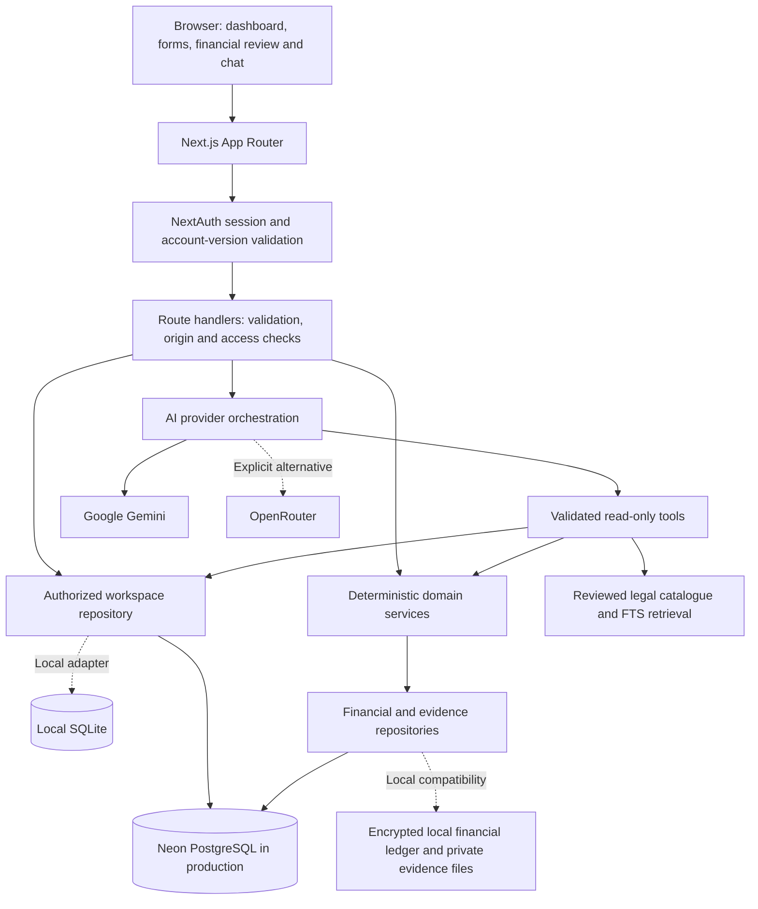
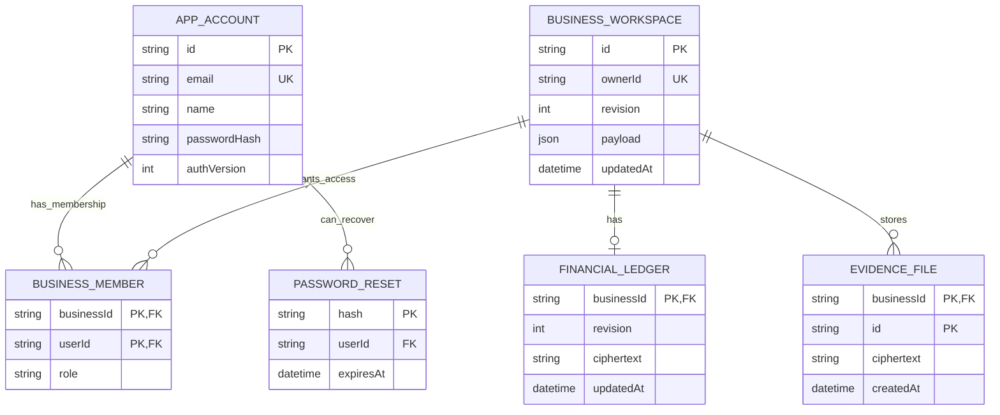
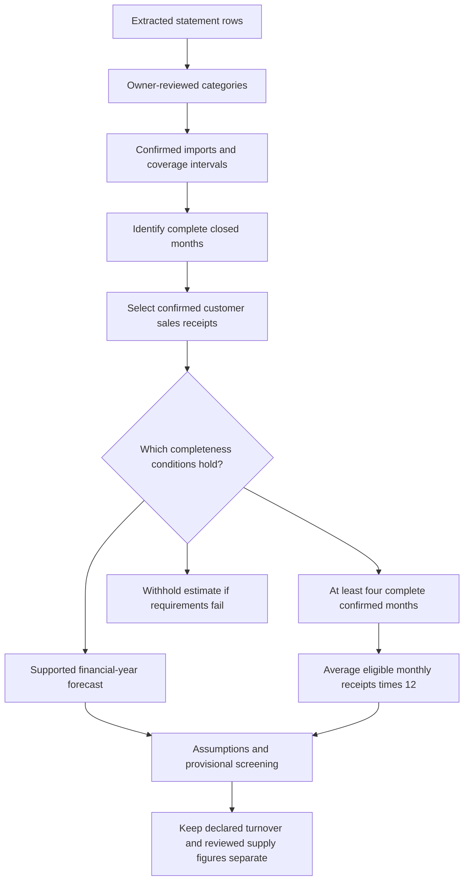

# Architecture and technical reference

[Live application](https://compliancecopilot-shayan.vercel.app) · **Team R²PS** · [Main README](../README.md) · [User workflows](USER-WORKFLOWS.md)

## 1. System boundary

ComplianceCopilot is a Next.js application with server-rendered pages, React client components and authenticated Node.js route handlers. The browser never connects directly to PostgreSQL or an AI provider using a private server key. The same deployment serves the UI and APIs.

The application is a modular monolith: components share domain code, but responsibilities are split into API, rules, finance, planning, AI and persistence modules. It is not a fleet of independently deployed microservices.

## 2. Request lifecycle

1. NextAuth resolves the credentials-based JWT session and checks the stored account's authentication version.
2. Route handlers identify the signed-in user and load a workspace through membership-aware repository functions.
3. Zod validates business inputs. Mutating APIs apply origin checks and applicable rate/size limits.
4. Domain services perform deterministic work or invoke a configured AI provider with authorized read-only tools.
5. Repositories persist changes with revision checks where implemented. A stale write is rejected rather than silently replacing a newer record.
6. The API returns the result or an understandable error. Private financial and evidence responses disable caching.

Not every route has an identical validation or limiting policy; inspect its implementation before extending it. Authorization remains a server-side responsibility, even if the UI hides a button.

## 3. Canonical persistence model

`ownerId` is an application ownership field; the diagram's relationship lines show the membership, reset and financial/evidence foreign-key relationships. `AuditEntry` stores workspace/actor/action metadata, and `RateBucket` stores attempt counters and expiry timestamps.

The workspace `payload` is the current aggregate for the profile, findings, tasks, notices, recorded certificates, document metadata, business events and saved planning analysis. It is not a separate normalized row for every domain object. Financial ledger content is separated because of review/versioning and encryption needs.

Legacy `User`, `SMEProfile`, `ComplianceRule`, `ApplicableLaw`, `ComplianceTask`, `RiskAlert`, `Notification`, `License`, `Registration` and `ActionPlan` models remain in the schema for compatibility with the earlier prototype. They should not be mistaken for the canonical current runtime architecture.

## 4. Storage and encryption

| Data | Production | Local development |
| --- | --- | --- |
| Accounts and workspace aggregates | PostgreSQL through Prisma | SQLite repository tables |
| Financial ledger | Encrypted `FinancialLedger.ciphertext` | Encrypted `financial_ledgers` row in SQLite |
| Imported financial originals | Encrypted content inside the encrypted financial aggregate | Same encrypted aggregate approach |
| Evidence bytes | Encrypted `EvidenceFile` rows, scoped by business/document IDs | Existing private upload files; legacy compatibility is retained |
| Legal excerpts and public search index | Repository source data plus per-instance in-memory SQLite FTS | Separate legal-index SQLite file |

AES-256-GCM authenticates encrypted financial/evidence content. Associated data binds ciphertext to the business and its purpose; production evidence is additionally bound to its document identity. A dedicated `FINANCIAL_DATA_KEY` may be supplied; otherwise HKDF derives a financial key from the stable authentication secret. Existing ciphertext must be re-encrypted through a controlled process before changing the key.

Workspace JSON is not claimed to be application-level encrypted. Passwords are salted hashes, not reversible encrypted plaintext. Local evidence compatibility is private filesystem storage, not a claim that every legacy file was retroactively encrypted.

On Vercel, `usesPostgres()` rejects missing PostgreSQL configuration and explicit/implicit SQLite business storage. The public legal index is rebuildable and instance-local there; it is not a persistent publishing mechanism for newly ingested source updates.

## 5. Financial pipeline

| Module | Responsibility |
| --- | --- |
| `parser.ts` | Supported CSV headings, amounts, dates and row validation |
| `files.ts`, `pdf-worker.mjs` | File limits, signatures and narrowly supported text-PDF extraction |
| `classification.ts` | Initial transaction category suggestions and reasons |
| `ledger.ts`, `reviews.ts` | Import identity, overlapping rows, review, coverage and corrections |
| `money.ts` | Exact integer-paise representation and conversion |
| `analytics.ts` | Monthly summaries, financial-year forecasts, annualized fallback and provisional warnings |
| `crypto.ts` | Authenticated encryption/decryption |
| `repository.ts` | Workspace-authorized, revision-aware encrypted persistence |
| `http.ts`, `request-body.ts` | Browser response handling, size validation and bounded request processing |

The annualization path is:

This is an estimate of cash-receipt sales activity under explicit assumptions. It does not reconcile invoices, tax periods, accrual accounting or every statutory supply rule. Category suggestions and projections cannot themselves establish a legal obligation.

## 6. AI and deterministic tools

Provider selection is centralized in `lib/ai-provider.ts`: Gemini by default; OpenRouter only when explicitly configured. Provider credentials remain server-side. `lib/assistant-tools.ts` defines typed read-only operations including:

- `read_business_records`
- `read_financial_summary`
- `search_legal_catalogue`
- `check_applicable_rules`
- `simulate_business_growth`
- `calculate_tax_or_contribution`
- `estimate_employee_costs`
- `read_compliance_plan`

Financial tools provide reviewed aggregates; they do not expose raw imported statements, transaction text or account labels. Tool arguments are validated and run in the already authorized workspace. Tool access is not general SQL access, filesystem access or an authorization bypass.

Live service errors remain errors. Explicit offline demonstration guidance is labeled separately and does not prove online AI connectivity. Rule, calculation and scheduling modules can operate without a provider key.

## 7. Main API surfaces

| Endpoint | Purpose |
| --- | --- |
| `/api/auth/[...nextauth]` | Sessions, credentials callback and optional configured OAuth |
| `/api/account`, `/api/account/signup`, `/api/account/reset` | Account and recovery operations |
| `/api/workspaces`, `/api/workspaces/[id]` | Create/read/update authorized workspace state |
| `/api/workspaces/[id]/simulate` | Read-only hypothetical business comparison |
| `/api/workspaces/[id]/evidence` | Validate and store private task evidence |
| `/api/workspaces/[id]/evidence/[documentId]` | Authorized evidence download |
| `/api/workspaces/[id]/report` | Workspace-derived report |
| `/api/financial-records` | Read/import/review/delete authorized financial records; original downloads via query parameters |
| `/api/chat`, `/api/chat/provider-check` | Assistant requests and provider diagnostics |
| `/api/calculations` | Validated deterministic tax/contribution calculations |
| `/api/planning`, `/api/growth-finance` | Preparation scheduling and growth-finance tools |
| `/api/legal-sources` | Legal-source features |
| `/api/jobs/deadlines` | Protected optional external monitoring job |

These are existing routes, not a promise of a public unauthenticated API. The product UI applies the correct request contracts; consult the route's Zod schema before writing another client.

## 8. Release and recovery

Production uses the existing GitHub repository, Vercel project and Neon database. Migrations are controlled separately from the build:

1. Confirm the intended production database and schema history.
2. Confirm recoverability before writes.
3. Baseline existing schema only after comparing it with the base migration.
4. Apply reviewed additive migrations; preserve existing table contents.
5. Check account access, persistence and schema.
6. Build through Vercel's read-only readiness gate and Next.js compilation.
7. Verify the public alias/commit and perform authenticated fictional-data smoke tests.

The latest release recorded successful schema migration, preservation fingerprints and production financial checks. One growth-simulation assertion failed and remains unresolved. A recovery snapshot exists and was confirmed by the owner, but a test restoration was not performed. No full disaster-recovery certification is claimed.

[Return to the main README](../README.md).
