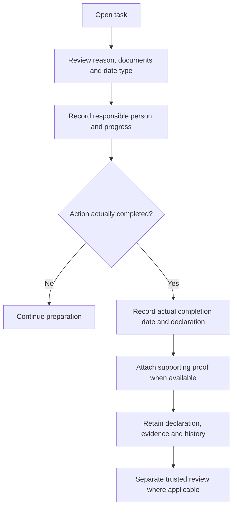

# User workflows and button guide

[Open ComplianceCopilot](https://compliancecopilot-shayan.vercel.app) · **Team R²PS** · [Main README](../README.md)

This guide describes the implemented workflows. A button may be disabled while processing, until required inputs are supplied, or when the action is unavailable in the public sample. Labels can vary slightly by compact/expanded view.

## 1. First visit: demo or private account

| Choice | What happens | What is saved? |
| --- | --- | --- |
| Try the public demo | Opens a fictional sample business | Sample state has browser-local/session behavior; it is not your authenticated database workspace. |
| Create an account | Creates credentials for a private workspace | Account and later business records are stored by the configured adapter. |
| Sign in | Opens your authorized saved business | Existing business and financial records remain associated with the account. |
| Complete the business profile | Supplies facts used for screening | The server validates and saves the profile; unsupported/unknown facts are not automatically established. |

**Sample versus real records:** loading a fictional statement in demo mode does not import your actual bank history. Refresh-persistence checks for the authenticated financial module do not imply that every public-demo state is persisted.

## 2. Business profile and real changes

Open the account menu and choose Business Profile / Settings. Review identity, activity, location, size, branches, turnover, registrations and relevant eligibility questions. Continue/Back moves through the form; the final save commits an actual change.

| Control | Meaning | Example |
| --- | --- | --- |
| Continue / Back | Move between profile steps | Review locations before registrations. |
| More details | Expose optional eligibility facts | Record prior EPF/ESI coverage rather than assuming headcount is the only test. |
| Save changes / final save | Save real facts and reevaluate supported rules | A genuine new branch becomes part of saved business history. |
| Cancel / Close | Leave the editor without submitting unsaved edits | Inspect a field without changing it. |
| Business change history | Inspect recorded facts and screening effects | Explain when an actual employee-count change was saved. |

**Scenario planning is different:** a proposed employee count belongs in Growth planner. It should not be saved as a real count until the change actually occurs.

## 3. Understand laws and warnings

Open **Applicable laws** to inspect each result. A finding may establish a supported trigger, indicate potential applicability or request more information. Always inspect scope, exceptions and missing facts.

| Control | What it does | What it does not do |
| --- | --- | --- |
| Recheck current facts | Reevaluates supported rules against saved facts | Does not perform a government verification. |
| Legal basis / conditions / source details | Shows the legal source and rule metadata | Does not guarantee every current state provision is covered. |
| Explain this result | Opens contextual assistant guidance | Does not change the underlying business facts. |
| Warning/task link | Opens the related issue or work item | Does not acknowledge or complete it merely by opening it. |
| Mark read / Mark all read | Updates notification-read state | Does not resolve the legal or operational issue. |

**Example:** a provisional annual receipt estimate can prompt a GST review. The owner should reconcile supplies, exemptions, registration facts and jurisdiction; the warning is not an automatic registration decision.

## 4. Track a task, dates and evidence

| Button or field | User benefit | Example |
| --- | --- | --- |
| Search / status filter | Find relevant work quickly | Show an unfinished EPF-related preparation task. |
| Track a dated obligation | Record a proposed obligation/date/reference | Track a filing whose source still needs review. |
| Your progress | Mark work Not started or In progress | Record that documents are being collected. |
| Responsible person / target date | Assign preparation responsibility | Set an internal target earlier than a legal deadline. |
| Save progress | Store progress without claiming completion | Preserve an owner note for the next session. |
| Submit completion | Open the completion declaration | Record a real action after it happens. |
| Actual completion date | Preserve when action occurred | A document uploaded later does not change the real action date. |
| Upload proof | Attach a validated private document | Submit an acknowledgment PDF or supporting text file. |
| Record completion declaration | Save date, declaration and selected evidence | Explain what the owner actually did. |
| Reopen for further work | Resume work while retaining history | Record why additional preparation is necessary. |
| Acknowledge for review | Record awareness of an issue | Keep an overdue issue visible until properly addressed. |
| Explain with Copilot | Ask for contextual guidance | Understand a task's documents or conditions. |

Proof types: PDF, PNG, JPEG, WebP or plain text, up to 2 MB. Downloads require authorization. Uploading a file is not itself legal fulfillment, and recording a declaration is not government acceptance.

### Calendar and certificates

Calendar Previous/Next changes the displayed month; Today returns to the current India-calendar month. Selecting a date narrows the view. Preparation targets, proposed dates and verified legal dates retain different meanings.

Add certificate opens owner-recorded registration/license details. Save certificate stores the record and its actual dates; selecting a row permits editing. Do not invent expiry or renewal dates. The feature is a record and review aid, not a government certificate-verification service or an enabled reminder-email system.

## 5. Import financial records and confirm a summary

Open **Business Profile → Financial Records**, or use the financial shortcut available in the dashboard.

1. Choose a supported CSV or text-PDF file. For a demonstration, use the deliberately fictional samples linked in the main README.
2. Enter an account **label**, not an account number, and the statement start/end dates.
3. Give processing consent and choose **Extract transactions**.
4. Inspect the detected column mapping, rows and proposed categories. Correct loans, investments, transfers and refunds that are not customer receipts.
5. Confirm that transactions have been reviewed and that the statement covers the declared period. Partial boundary months remain partial even when the statement itself is confirmed.
6. Choose **Confirm reviewed summary** and inspect the resulting monthly figures, forecast assumptions, incomplete months and warnings.
7. Sign out/in or reload the authenticated workspace to retrieve the stored data again.

| Control | What it does | Example |
| --- | --- | --- |
| Load fictional jury statement | Loads a labeled local sample in the demo | Demonstrate review without uploading a real document. |
| Extract transactions | Validates/extracts supported rows and proposes categories | Review a 36-row fictional statement. |
| Category selector | Changes the owner's proposed classification | Mark an owner investment as non-sales. |
| Review filter / Previous rows / Next rows | Navigate and focus review | Inspect uncertain transactions before confirmation. |
| Save corrections | Stores corrections without treating unfinished review as complete | Continue reviewing later. |
| Confirm reviewed summary | Saves explicit review/coverage confirmation and recalculates summaries | Enable an eligible provisional estimate. |
| Average / weighted method | Recalculates the requested supported forecast presentation | The fallback still discloses its actual simple annualization method. |
| Download original | Downloads the authorized encrypted-at-rest original through the server | Compare extracted rows against the imported document. |
| Save owner-reviewed figure | Stores a separately defined, referenced figure for the selected financial year | Record a reconciled supplies figure without overwriting declared turnover. |
| Explain these financial estimates with Copilot | Requests a contextual explanation | Ask why April and September were excluded. |
| Delete transaction | Removes a selected authorized row and recalculates completeness/estimates | Correct a mistaken fixture row after confirming the destructive action. |
| Delete statement | Removes that import and its original; shared rows follow overlap rules | Remove a mistakenly imported fictional statement. |
| Delete all imported financial data | Clears that workspace's imported financial module after confirmation | This is a destructive owner action, not a routine refresh or repair step. |

**Expected example:** May–August customer receipts of ₹3.5 lakh, ₹3.5 lakh, ₹3.5 lakh and ₹3.75 lakh produce a provisional ₹42.75 lakh annual run-rate. It remains an estimate and never replaces the owner's declared turnover automatically.

## 6. Plan growth before changing facts

Growth planner compares the current business with a hypothetical proposal. The compact form asks for a new **total** headcount, planned turnover and supported branch/export changes. “Grow to 50” and “hire 50 additional people” have different meanings; ambiguous chat requests should be clarified.

| Control | What it does |
| --- | --- |
| Compare my growth plan | Validates the proposal and requests a temporary rules comparison. |
| More options | Opens additional business/activity/eligibility inputs. |
| Generate Growth Readiness Plan | Shows preparation actions and missing facts for the proposed scenario. |
| Hide readiness plan | Collapses that explanation. |
| Workforce / finance view | Changes the planning perspective available in the screen. |

The intended simulation does not save actual headcount, turnover, tasks or registrations. The latest production smoke test failed an assertion in this workflow; the root cause has not been established. Do not present growth planning as fully production-verified until that check is resolved.

## 7. Build a preparation schedule

The task section's planner considers a bounded set of tasks and user-provided resources.

| Control | Meaning |
| --- | --- |
| Judge example | Load a labeled fictional constraint scenario. |
| Load my tasks | Import supported unfinished saved tasks for preparation planning. |
| Task/resource inputs | Set estimated costs, hours, mandatory work, dependencies and responsible people. |
| Find a feasible plan | Run the deterministic scheduler. It may report infeasibility or a feasible result. |
| Export analysis | Download the result and assumptions. |
| Save analysis for Copilot | Save the analysis so the assistant can explain it. |
| Explain chosen plan | Ask why tasks were selected and what shortfalls remain. |

Missing mandatory work is not a recommended strategy. Example task costs and importance scores are assumptions, not verified statutory fees or legal risk probabilities. A search-limited result does not claim proven optimality.

## 8. Ask Copilot and use calculators

| Control | Action |
| --- | --- |
| Message box / Send | Submit the question and active conversation context. |
| Quick prompt | Fill/send a supported example question such as POSH or EPF review. |
| Loading indicator | Shows that the request is being processed. |
| Retry | Retry a failed provider/request operation. |
| New conversation | Start a new active conversation context. |
| Clear history | Remove chat history after confirmation; this does not delete financial records. |
| Copy | Copy an answer for personal use. |
| More details / source links | Expand the explanation and inspect source/review limitations. |
| Explicit offline judge mode in demo | Request labeled local guidance instead of an online model call. |
| Tax & contribution tools | Open supported deterministic calculators. |

The configured live AI requires provider credentials, model access and quota. Live errors remain visible; they are not silently replaced with local text. A provider being configured is not proof it is currently reachable.

Calculators need explicit inputs: GST rate and supply basis, eligibility and wage bases for contributions, or the supported taxpayer/year assumptions for income-tax scenarios. The result should be read with its assumptions and exclusions.

## 9. Reports, exports and privacy

Download PDF report produces a current-workspace report. Export business data downloads structured data. Keep these exports private. Neither control files a return, pays a fee or sends records to a regulator.

Use Sign out on shared machines. Do not share private credentials, bank statements, exported workspace data or environment files through the public repository. The public samples are fictional and intentionally shareable.

## 10. What was actually verified

The latest release passed production login, dashboard access, compliance findings, CSV extraction, owner confirmation, classification recalculation, exact provisional annualization, fresh-login financial persistence, original downloads and private encrypted evidence storage. One growth simulation assertion failed; browser visual/click acceptance and live AI generation were not established by those financial HTTP tests.

[Return to the main README](../README.md).
